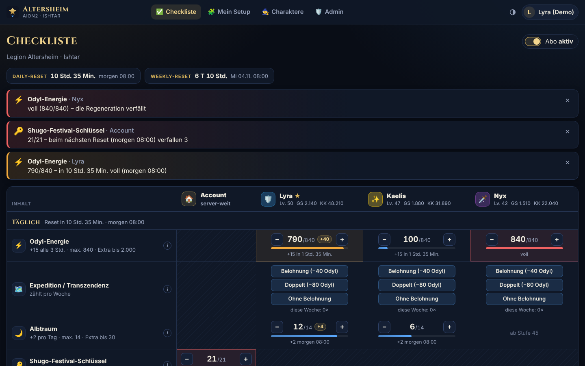
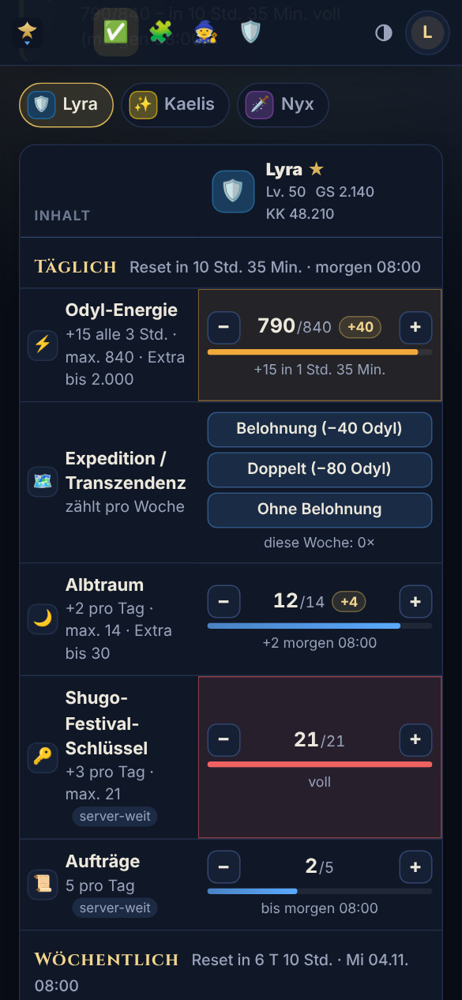
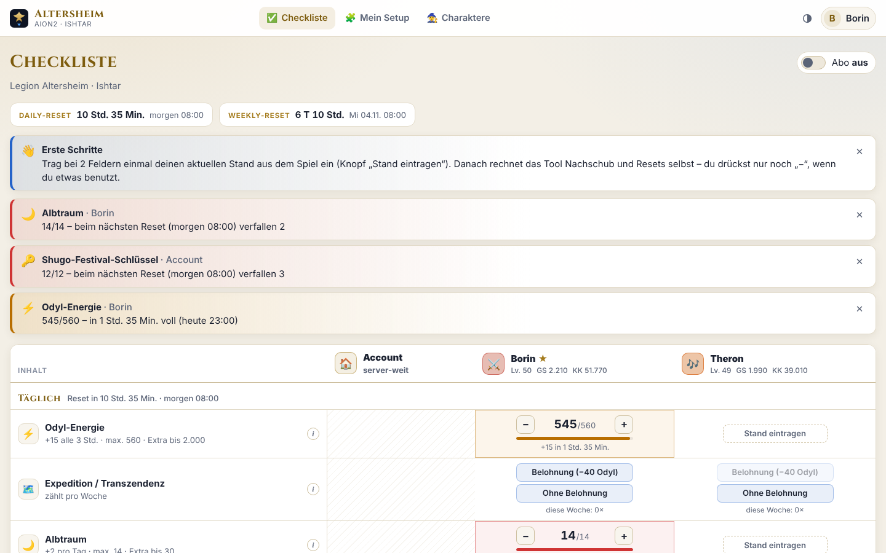
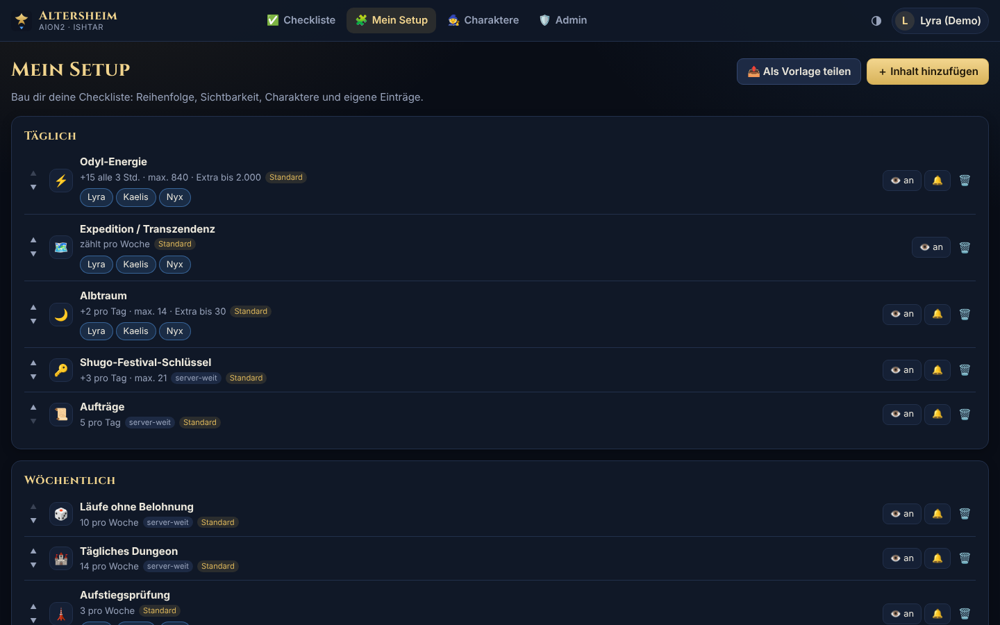

# AION2Tool – Checkliste der Legion Altersheim

Web-Tool für die Daily- und Weekly-Checkliste in **AION2** – im Stil von BynnArk für Lost Ark, aber nur für die Legion **Altersheim** auf **Ishtar (EU)**.

Jeder baut sich seine eigene Checkliste zusammen. Das Tool rechnet Odyl-Energie, Albtraum-Tickets, Shugo-Schlüssel und Wochen-Kontingente selbst hoch und warnt, **bevor etwas überläuft oder verfällt**. Charakterwerte (Kampfkraft, Gegenstandsstufe, Legion) kommen automatisch von PlayNC.



| Handy | Hell | Mein Setup |
|---|---|---|
|  |  |  |

## Funktionen

| Bereich | Was es kann |
|---|---|
| ✅ **Checkliste** | Raster wie bei BynnArk: Zeilen = Inhalte, Spalten = Account (server-weit) + Charaktere mit Klasse, Stufe, Gegenstandsstufe und Kampfkraft. Countdown bis Daily- und Weekly-Reset. Auf dem Handy ein Charakter pro Ansicht. |
| 🔢 **Zähler** | Regeneration (Odyl +15 alle 3 Std.), stapelnde Tickets (Albtraum +2/Tag bis 14), Kontingente (Tägliches Dungeon 14/Woche), Haken und Knöpfe. „−“ = benutzt, „+“ = erhalten, Klick auf die Zahl = echten Ingame-Stand eintragen. Jede Änderung lässt sich rückgängig machen. |
| 🎁 **Extra-Vorrat** | Tickets/Energie aus Items (z. B. Albtraum-Herausforderungstickets) landen in einem eigenen Vorrat – wie im Spiel: zählt nicht gegen das Maximum, verfällt nicht und wird erst nach dem natürlichen Vorrat verbraucht. |
| 🗺️ **Expedition/Transzendenz** | Knöpfe „Belohnung (−40 Odyl)“, mit Abo „Doppelt (−80 Odyl)“ und „Ohne Belohnung“ (zählt gegen die 10 Läufe pro Woche, server-weit). Reicht die Energie nicht, sagt das Tool warum. |
| 🔔 **Warnungen** | Banner, wenn morgen Tickets verfallen, die Energie bald voll ist oder ein Wochen-Kontingent vor dem Reset noch offen ist. Pro Eintrag stummschaltbar, Vorlaufzeiten einstellbar. |
| 💎 **Abo** | Schalter für die Spezielle Quai-Mitgliedschaft: höhere Maxima (Odyl 840, Shugo-Schlüssel 21) und der Knopf „Doppelt“. |
| 🧩 **Mein Setup (Builder)** | Reihenfolge, ein-/ausblenden, pro Charakter an/aus, Warnungen stumm. Inhalte hinzufügen aus dem Standard, aus Vorlagen anderer Mitglieder oder komplett eigene Einträge bauen. Eigenes Setup als Vorlage teilen. |
| 🧙 **Charaktere** | Main + bis zu 7 Twinks. Werte von PlayNC (alle 6 Std. automatisch, Twinks alle 12 Std., jederzeit per Knopf). |
| 🛡️ **Admin** | Standard-Einträge pflegen (nach Patches Werte anpassen), Mitglieder (sperren, Offiziere ernennen, Charaktere lösen, Legion prüfen), Anfragen bei doppelt beanspruchten Charakteren, **Fortschritt der Legion** (wer hat diese Woche was erledigt), Vorlagen in den Standard übernehmen, Protokoll. |

## Zugang & Legions-Prüfung

Login über **Steam**. Danach trägt man seinen **Main** ein – das Tool prüft bei PlayNC (Feld `regionName` der Charakter-Info), ob er in der Legion **Altersheim** ist. Twinks dürfen in jeder Legion sein, müssen aber auf Ishtar spielen.

| Situation | Was passiert |
|---|---|
| Main ist in Altersheim | sofort freigeschaltet |
| Main (noch) nicht in Altersheim | „wartet auf Bestätigung“ – automatische Nachprüfung 2 Std. lang alle 10 Min., danach 3 Tage stündlich, jederzeit per Knopf |
| Mitglied steht nicht mehr in Altersheim | erst wenn **zwei Prüfungen im Abstand von mind. 1 Std.** das zeigen → Zugang gesperrt (Daten bleiben erhalten) |
| Wieder in Altersheim | automatisch wieder freigeschaltet |
| Offiziere / Haupt-Admins | werden nie automatisch ausgesperrt, nur protokolliert |
| **Notbremse** | Stehen ab 3 Mitgliedern gleichzeitig (bzw. 20 % ab 10 bestätigten Mitgliedern) nicht in der Legion, wird niemand ausgesperrt (vermutlich PlayNC-Fehler) |
| Charakter gehört schon einem anderen Account | Anfrage an die Offiziere; sie können ihn im Admin-Bereich übertragen |

Steam liefert nur eine Steam-ID und keinen Bezug zum AION2-Charakter. Deshalb gehört jeder Charakter **genau einem** Steam-Account (wer ihn zuerst einträgt), Streitfälle klären die Offiziere über „Anfragen“.

## Schnellstart (Windows-Server)

1. **Node.js 24 LTS** installieren (mindestens 22.13): <https://nodejs.org>
2. Projekt herunterladen (`git clone …`) und im Ordner `.env.example` nach **`.env`** kopieren.
3. In der `.env` mindestens eintragen:
   - `PUBLIC_URL` – die Adresse, unter der das Tool erreichbar ist, z. B. `https://aion2.domain.de`
   - `PORT` – z. B. `1234`
   - `ADMIN_STEAM_IDS` – deine SteamID64 (17 Ziffern), siehe unten
   - optional `STEAM_API_KEY` für Steam-Name und Avatar
4. `scripts\start.bat` doppelklicken (installiert, baut und startet).
5. Im nginx Proxy Manager die Domain auf den Server weiterleiten (siehe unten) und `https://aion2.domain.de` öffnen.

**Als Windows-Dienst** (startet automatisch mit Windows): [NSSM](https://nssm.cc) installieren (`winget install NSSM.NSSM`), dann in einer Admin-PowerShell `.\scripts\install-service.ps1`. Logs liegen in `logs\`.

### Steam einrichten

- **SteamID64 finden:** Im Steam-Client auf das Profil → URL kopieren; steht dort ein Name statt Zahlen, die URL bei <https://steamid.io> eingeben. Gebraucht wird die 17-stellige Zahl (beginnt mit `7656119…`).
- **Steam-Web-API-Key (empfohlen):** <https://steamcommunity.com/dev/apikey> – als Domain die eigene Domain angeben. Der Key wird nur für Name und Avatar genutzt; ohne Key heißen die User „Steam-User …1234“.
- `PUBLIC_URL` muss **genau** der Adresse im Browser entsprechen (inkl. `https://`, ohne `/` am Ende). Steam schickt den Login dorthin zurück.

### nginx Proxy Manager

*Hosts → Proxy Hosts → Add Proxy Host*

| Feld | Wert |
|---|---|
| Domain Names | `aion2.domain.de` |
| Scheme | `http` |
| Forward Hostname / IP | IP des Windows-Servers, z. B. `123.123.123.123` |
| Forward Port | der `PORT` aus der `.env`, z. B. `1234` |
| Block Common Exploits | an |
| Websockets Support | nicht nötig |
| SSL | *Request a new SSL Certificate* (Let's Encrypt), **Force SSL** und **HTTP/2** an |

Danach ist das Tool unter `https://aion2.domain.de` erreichbar. Der Proxy Manager setzt die nötigen Header (`Host`, `X-Forwarded-Proto`, `X-Forwarded-For`) bereits standardmäßig.

**Wichtig:** Der Port des Tools sollte nur für den Proxy Manager erreichbar sein, nicht direkt aus dem Internet. Läuft der Proxy Manager auf **demselben** Rechner: `HOST=127.0.0.1` in der `.env`. Läuft er auf einem **anderen** Rechner: Windows-Firewall-Regel nur für dessen IP, z. B. in einer Admin-PowerShell:

```powershell
New-NetFirewallRule -DisplayName "AION2Tool" -Direction Inbound -Protocol TCP -LocalPort 1234 -RemoteAddress 10.0.0.5 -Action Allow
```

(`10.0.0.5` = IP des Proxy Managers.)

## So rechnet das Tool

Gespeichert wird nur „Stand X zum Zeitpunkt Y“. Alles andere rechnet das Tool aus den Regeln selbst hoch – auch über Tage, an denen niemand reinschaut. Wer im Spiel etwas anderes sieht, klickt auf die Zahl und trägt den echten Stand ein; ab da wird weitergerechnet.

| Art | Beispiel | Verhalten |
|---|---|---|
| Regeneration | Odyl-Energie | +Menge alle X Stunden bis zum Maximum. Über dem Maximum (z. B. Abo abgelaufen) gibt es keinen Nachschub, es wird aber nichts gekürzt. |
| Stapelnde Tickets | Albtraum, Shugo-Schlüssel | +Menge bei jedem Reset bis zum Maximum. Warnung, wenn beim nächsten Reset etwas verfällt. |
| Kontingent | Tägliches Dungeon, Aufstiegsprüfung | Bei jedem Reset wieder voll, Rest verfällt. Warnung vor dem Reset (einstellbar). |
| Haken | eigene Einträge | Abhaken, beim Reset wieder offen. |
| Knöpfe | Expedition/Transzendenz | Verändern andere Zähler (z. B. −40 Odyl) und zählen die Nutzungen pro Woche. |

- **Resets:** Standard ist **07:00 UTC** täglich, Weekly am **Mittwoch** (= 08:00 deutscher Winterzeit, 09:00 Sommerzeit). Anpassbar in der `.env` (`RESET_TIME`, `RESET_TIMEZONE`, `RESET_WEEKDAY`).
- **Odyl-Ticks:** Ohne Angabe liegen die Ticks auf der Reset-Uhrzeit (07:00, 10:00, 13:00 … UTC). Stimmt das nicht mit dem Countdown im Spiel überein, im Admin-Bereich beim Eintrag die „Uhrzeit eines Ticks“ setzen.
- **Server-weit** (Account): Shugo-Schlüssel, Aufträge, Tägliches Dungeon, Läufe ohne Belohnung, Befehls-Schriftrollen – ein Stand für alle Charaktere.

### Standard-Einträge (Stand Oktober 2026)

| Inhalt | Regel | Gilt für |
|---|---|---|
| Odyl-Energie | +15 alle 3 Std., max. 560 / 840 mit Abo, Extra-Vorrat aus Items | Charakter |
| Expedition / Transzendenz | Belohnung −40 Odyl (Abo: Doppelt −80), ohne Belohnung −1 Lauf | Charakter |
| Albtraum | +2 pro Tag, max. 14, Extra-Vorrat bis 30, ab Stufe 45 | Charakter |
| Shugo-Festival-Schlüssel | +3 pro Tag, max. 12 / 21 mit Abo | server-weit |
| Aufträge | 5 pro Tag | server-weit |
| Läufe ohne Belohnung | 10 pro Woche (Expedition + Transzendenz zusammen) | server-weit |
| Tägliches Dungeon | 14 pro Woche | server-weit |
| Aufstiegsprüfung | 3 pro Woche | Charakter |
| Abyss-Zeit (je Ebene) | 7 Std. pro Woche | Charakter |
| Schlachtfeld-Siege | 3 pro Woche | Charakter |
| Arena-Siege | 30 pro Woche | Charakter |
| Befehls-Schriftrollen PvE / PvP | 12 / 20 pro Woche | server-weit |

Die Werte stammen aus Community-Quellen und der Legion – **offizielle Zahlen für Global gibt es kaum**. Nach einem Patch passen Offiziere die Werte unter *Admin → Standard-Einträge* an; das gilt sofort für alle, gespeicherte Stände bleiben erhalten. Heiligtum, Unterwerfung, Dimensions-Invasion usw. kann jeder als eigenen Eintrag anlegen – oder Offiziere übernehmen eine geteilte Vorlage in den Standard.

## PlayNC

PlayNC hat **keine dokumentierte API**. Das Tool nutzt – wie der Legions-Bot – die internen JSON-Schnittstellen der offiziellen Website:

- Charaktersuche: `api-search.plaync.com/aion2global/search/v2/character` (Region `eu`, Ishtar = `1319`)
- Charakter-Info: `aion2.plaync.com/api/character/info` (Klasse, Stufe, Kampfkraft, Gegenstandsstufe, Legion)

Abfragen laufen in einer Warteschlange (mind. 1,5 s Abstand, 10 Min. Pause bei 403/429). Im Hintergrund werden pro Minute bis zu 4 fällige Charaktere abgefragt. User können höchstens 10 Abfragen pro 10 Minuten auslösen. Ändert PlayNC die Schnittstellen, zeigt die Charakterseite den Fehler; die Checkliste funktioniert weiter.

## Updates

Am einfachsten (Dienst wird gestoppt, Datenbank gesichert, aktualisiert, neu gestartet):

```powershell
.\scripts\update.ps1
```

Von Hand: Tool beenden → Ordner `data` sichern → `git pull` → `npm install` → `npm run build` → starten. `.env` und `data` bleiben unverändert.

## Datensicherung

Alles liegt in **einer Datei**: `data\aion2tool.sqlite` (plus `-wal`/`-shm` während des Betriebs). Zum Sichern den Dienst kurz stoppen (`nssm stop AION2Tool`) und den Ordner `data` kopieren – oder `scripts\update.ps1` nutzen, das vor jedem Update eine Sicherung anlegt.

## Datenschutz

Gespeichert werden: Steam-ID, Steam-Name und Avatar-Adresse, eingetragene Charaktere mit den öffentlichen PlayNC-Werten, die Checklisten-Stände und ein Protokoll für Offiziere. Unter *Einstellungen → Account löschen* lässt sich der eigene Account samt allen Daten jederzeit löschen.

## Ausprobieren & Entwickeln

```bash
npm install
npm run demo        # Demo mit Beispiel-Legion und simuliertem PlayNC auf http://localhost:3000
npm test            # alle Tests (Zähler, Resets, Steam-Login, Legions-Prüfung, API)
npm run typecheck   # TypeScript prüfen (Server + Oberfläche)
```

Im Demo-Modus meldet man sich ohne Steam an: `http://localhost:3000/auth/dev` (Haupt-Admin „Lyra“), `…/auth/dev?steamid=76561190000000002` (Mitglied „Borin“) oder `…/auth/dev?steamid=76561190000000099&name=Neu` (neuer User).

Für Änderungen an der Oberfläche mit Live-Neuladen: Server starten (`npm run demo`) und parallel `npx vite` – die Vite-Seite leitet `/api` und `/auth` an Port 3000 weiter.

**Technik:** Node.js + TypeScript, [Fastify](https://fastify.dev), SQLite über das eingebaute `node:sqlite` (kein nativer Build nötig), Oberfläche mit React + Vite, Schrift Cinzel lokal eingebunden (keine externen Server). Aufbau:

```
src/shared/   Regeln für Zähler & Resets (Server und Oberfläche nutzen denselben Code), Standard-Einträge
src/server/   Login (Steam OpenID), API, Legions-Prüfung, PlayNC, Datenbank
src/web/      Oberfläche (Checkliste, Mein Setup, Charaktere, Einstellungen, Admin)
src/demo/     Demo-Modus mit simuliertem PlayNC
src/tests/    Tests
```
